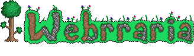

  
  

  <strong>A web port of Webrraria!</strong>
  

  
  &nbsp;
  

---

### What's Webrraria?
A web port of Terraria that's currently in demo. It has 2-player multiplayer, singleplayer, workshops, and world saving. 

### Is it finished? 
No. We plan to add more things in the future, such as more mobs, biomes and maybe a few bosses.
